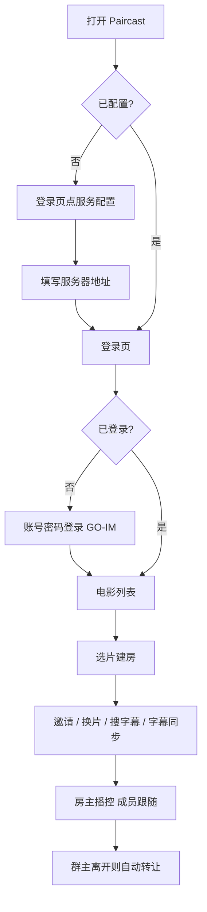

# Paircast 产品需求文档（PRD）

> 版本：v2.1  
> 日期：2026-11-02  
> 状态：草案（待评审）  
> 产品定位：异地好友同步观影 + 实时聊天  
> 客户端：**iOS（SwiftUI）+ Android（Jetpack Compose）**，业务逻辑以 Kotlin Multiplatform 共享  
> 交互形态：**单页应用（SPA）**；「我的」入口在页面**右上角**
> 变更摘要（v2.1）：**片库配置移到服务端**——对象存储、TMDB、OpenSubtitles 凭证只在 GO-IM 服务端配置，客户端只填 GO-IM 服务器地址；GO-IM 提供标准化的片源 / 影片列表 / 播放直链 / 字幕 / 贴纸接口（本期支持 S3 兼容存储，后续可接 openlist / Emby / Jellyfin）；房间状态由服务端管理（MySQL），不再写对象存储 `_paircast/`；**去掉配置分享 / 导入**（客户端只剩服务器地址，直接填写即可），服务配置页附「配置指南」与「服务端部署指南」；文案统一称「服务器」；**新增邮箱注册**（默认开放，管理员可在服务端关闭；需服务器配置 SMTP），注册 / 登录前须勾选同意《用户协议》《隐私政策》，「删除账号」改为验证密码后在服务器上真正注销账号；**聊天屏蔽 / 举报存到服务端**（屏蔽名单跟账号走，举报进入服务端待处理队列），管理员在「我的 → 举报处理」中查看，可忽略或封禁被举报用户。  
> 变更摘要（v2.0）：IM 由腾讯云 IM 换成**自托管 GO-IM**；登录改为**账号 + 密码**（管理员可要求首次登录改密）；服务配置只需 GO-IM 服务器地址；新增 Android 客户端，可与 iOS 同房观影。v1.x 的腾讯云 IM 版本归档在 `archive/ios-tencent-im` 分支。

---

## 1. 产品概述

### 1.1 背景与问题

异地好友想一起看电影时，常见痛点：

- 各自打开本地/网盘资源，进度容易不同步
- 依赖微信语音/文字，观影与聊天割裂
- 缺少「谁在看、邀请谁、房间内即时吐槽」的轻量闭环
- 外挂字幕与片源分离，切换麻烦

### 1.2 产品目标

**Paircast** 是一款 **iOS / Android 原生 App**（两端可同房），让两人（或多人也预留扩展）在同一部影片的播放房间内：

1. 首次填写服务器地址，再用邮箱注册（服务器开放注册时）或管理员分配的账号密码登录，维护昵称/头像；片库由管理员在服务端配置
2. 从云端片库选择影片进入播放（支持 **mp4 / mkv**）
3. 在播放页看到同房成员、发起邀请、边看边聊；**可在播放页切换当前影片**（房主切换，全员跟随）
4. **播放进度与播放/暂停状态同步**（跟房观影）；**群主离开后自动转让**
5. **字幕**：内嵌 / 片库外挂 / **在线搜索**；支持 **字幕时间轴同步（延迟校准）**

### 1.3 成功指标（MVP）

| 指标 | 定义 | 目标（MVP） |
|------|------|-------------|
| 登录成功率 | 输入正确凭证后进入片库 | ≥ 95% |
| 邀请到达率 | 邀请发出后被邀方能进入同一房间 | ≥ 90% |
| 聊天可达性 | 房间内消息双方可见延迟 | P95 < 1s |
| 进度同步偏差 | 跟房方与房主进度差（稳态播放） | P95 < 1.5s |
| 片库可用性 | 服务端片源可列出且元数据可展示 | ≥ 90% 影片有封面+标题 |
| 字幕可用性 | 有字幕资源的影片可成功展示至少一路字幕 | ≥ 95% |
| 在线搜字幕成功率 | 有匹配结果时用户能成功加载并显示 | ≥ 85% |
| 房主转让成功率 | 群主离开且仍有成员时，新房主接管播控 | ≥ 98% |

### 1.4 平台与形态

| 项 | 决策 |
|------|------|
| 客户端 | **iOS（SwiftUI）+ Android（Compose）**；共享层 Kotlin Multiplatform |
| 交互形态 | **单页应用（SPA）**：主壳为片库；播放/我的/配置以页内路由或浮层呈现；**无底部 Tab** |
| 「我的」入口 | 主页面导航栏 **右上角**（头像或「我的」按钮） |
| Web / 桌面 | 本期不做 |
| 账号 | **邮箱 + 验证码注册**，默认开放；管理员可在服务端关闭注册，关闭后只能由管理员创建账号 |
| 片源封装 | 主要 **mp4、mkv** |
| 元数据 | 服务端刮削：**同目录 NFO / 海报优先**，否则 TMDB 官方 API，再降级文件名 |
| 云服务 | App 内只配置 **服务器地址**（GO-IM，手动填写）；片源（S3 兼容存储：七牛 / OSS / COS / MinIO 等）、TMDB、OpenSubtitles 由管理员在 GO-IM 服务端配置 |
| 房主离开 | **自动转让**给下一位在房成员（非散房） |

### 1.5 非目标（本期不做）

- App 内找回密码（服务端已有接口，客户端本期不接）、手机号、OAuth
- Web / 桌面客户端
- 弹幕、表情包商店、付费片库
- 清晰度多码率切换、HLS/m3u8 为主流方案
- 版权合规的公开流媒体分发（片源为用户自有资源，由管理员接入 GO-IM 服务端片源）
- 多套云配置切换账号（MVP 单套有效配置；可覆盖更新）

---

## 2. 角色与场景

### 2.1 角色

| 角色 | 说明 |
|------|------|
| 房主 / 群主（Host） | 进入影片并创建观影房间的人；可邀请好友；**掌握播放进度权威源**；离开时**自动转让** |
| 观影成员（Member） | 通过邀请进入同一房间；**默认跟随房主进度**；可搜字幕、调字幕同步 |
| 访客（未登录） | 仅能看到登录页与**服务配置入口**；未完成配置前不可登录 |

### 2.2 核心场景

**场景 A：两人同步约看一部片**

1. A 用预置账号登录 → 片库选片 → 进入播放页（自动建房，A 为房主）  
2. A 点「邀请」→ 通过系统分享 / IM 会话把邀请发给 B  
3. B 登录后进入同一房间 → 成员列表、聊天可见  
4. A 播放/暂停/拖进度 → B **自动跟随**；双方边看边聊，可各自开关字幕  

**场景 B：改昵称/头像再约看**

1. 用户点主页**右上角「我的」** → 修改昵称、更换头像 → 保存  
2. 房间成员列表与聊天气泡展示新资料  

**场景 C：中途加入 / 群主离开转让**

1. B 晚于 A 进入：拉取房主当前进度并对齐；看到成员与最近聊天  
2. 普通成员离开：成员列表更新，播控不变  
3. **群主离开且仍有成员**：自动将房主转让给下一位成员 → 系统消息「房主已转让给 xxx」→ 新房主接管播控与心跳  
4. 最后一人离开：房间结束  

**场景 D：字幕（含在线搜索与时间轴同步）**

1. 进入播放页 → 点字幕 → 可选内嵌 / 片库外挂 / **在线搜索**  
2. 在线搜索：按片名/年份检索 → 选一条下载并加载  
3. 若字幕快/慢半拍：打开 **字幕同步**，用 ± 延迟校准（仅本机）
4. **房主**选外挂/在线字幕后经服务端共享并通知成员加载同一份；**成员**自行下载/选择仅本机生效
5. 字幕时间轴偏移 **仅本机生效**，不影响对方语言偏好

**字幕共享（房主）：**

```
房主点选外挂/在线字幕
  → 经服务端下载到本机并加载
  → 片库外挂：直接广播其服务端 ref（src:…）
    在线 / 本机字幕：POST /media/subtitles/share 上传到 GO-IM 存储，得到 ref（blob:…），并记入房间
  → 播控信令 subtitle_change{ subtitleObjectKey = ref, subtitleLabel }
成员收到信令（或后加入时读房间 subtitle_ref）
  → GET /media/subtitle?ref= 下载 → 本机加载（保留本机偏移）
```

同目录同名外挂也会出现在「片库外挂」列表。内嵌字幕轨无法导出文件，不同步。字幕同步（偏移）始终本机。

**场景 E：首次配置服务器**

1. 打开 App → 登录页点「服务配置」→ 填写管理员告知的服务器地址（如 `im.example.com`）→ 保存  
2. 返回登录，用管理员分配的账号密码登录；服务器开放注册时也可点「注册账号」用邮箱自助注册  
3. 还没有服务器的用户：服务配置页 →「服务端部署指南」，按 Docker 步骤自建 GO-IM 后再填写地址  

**场景 F：播放中换片**

1. 房主在播放页点「切换影片」/ 片名旁入口 → 从片库列表选另一部  
2. 确认后本房换到新片，进度归零；成员自动加载同一部并跟随  
3. 聊天与房间保留；系统消息提示「房主切换了影片：xxx」  
4. 成员侧不可主动换片（点入口提示「仅房主可切换影片」）  

---

## 3. 信息架构与页面结构

采用 **单页应用（SPA）** 结构：已登录后常驻一个主壳页面（片库），其它功能以 **同壳内路由切换 / 全屏覆盖 / Sheet** 打开，**不使用底部 Tab Bar**。

```
未登录（可视为 SPA 外前置页，或同壳未认证态）
├── 登录页（含「服务配置」入口；服务器开放注册时显示「注册账号」）
├── 注册页（邮箱 + 验证码 + 密码）
└── 服务配置（从登录进入；Sheet / 推入）

已登录 · 单页主壳
└── 电影列表（唯一主页面）
    ├── 导航栏左侧：产品名 / 刷新（可选）
    ├── 导航栏右侧：「我的」入口（头像或图标）★
    ├── 点击影片 → 播放页（全屏覆盖主壳，返回后回到列表态）
    └── 点击右上角 →「我的」面板/页
         ├── 个人信息（昵称、头像）
         ├── 服务配置
         └── 退出登录
```

### 3.1 主壳线框（片库 SPA）

```
┌─────────────────────────────────┐
│ Paircast              [我的/头像] │  ← 右上角入口
├─────────────────────────────────┤
│                                 │
│         电影卡片列表             │
│                                 │
└─────────────────────────────────┘
```

### 3.2 全局导航规则

- **无 Tab Bar**；主路径始终落在片库单页  
- **右上角「我的」**：点击后以 Sheet（半屏/全屏）或推入子页展示个人中心；关闭后仍在片库  
- **播放页**：覆盖式进入（隐藏主壳导航）；返回手势/按钮回到片库，右上角「我的」在播放页**默认不展示**（避免误触；个人设置回片库再进）  
- **登录页**：主流程登录 +「服务配置」；登录成功进入 SPA 主壳  
- Deep Link：`paircast://watch?...`（及 `https://paircast.chaisz.com/invite/…`）进入后落到对应 SPA 路由态  
- 遵循 iOS 安全区、横竖屏（播放页优先横屏全屏）

### 3.3 路由态（产品级）

| 路由态 | 说明 |
|--------|------|
| `/login` | 未登录 |
| `/register` | 邮箱注册（从登录进入） |
| `/config` | 服务配置（可从登录或「我的」进入） |
| `/` 或 `/movies` | 片库主壳（默认） |
| `/me` | 我的（由右上角打开） |
| `/watch/:roomId` | 播放页覆盖态（可在页内打开「切换影片」选片层） |
---

## 4. 功能详述与交互说明

### 4.1 登录与注册

#### 4.1.1 目标

在完成服务配置后，使用**账号 + 密码**登录进入片库。账号来源两种：用户在 App 内**用邮箱自助注册**（默认开放），或由管理员在 GO-IM 创建。

#### 4.1.2 界面元素

| 元素 | 说明 |
|------|------|
| Logo / 产品名 | Paircast |
| 账号输入框 | GO-IM UID 或邮箱；必填 |
| 密码输入框 | 必填；可显隐切换 |
| 登录按钮 | 主按钮；**未完成必要配置时点击提示先配置** |
| 服务配置入口 | **次要按钮/文字链「服务配置」**（登录页必有） |
| 协议勾选 | 「我已阅读并同意《用户协议》和《隐私政策》」，两个名称可点开对应网页（`/{zh-Hans|en-US}/terms/`、`/privacy/`）；**默认不勾选**，未勾选点登录 / 注册提示「请先阅读并同意《用户协议》和《隐私政策》」；登录页与注册页共用同一勾选状态（本次启动内有效，不持久化） |
| 配置状态提示 | 未配置时显示「请先完成服务配置」；已配置显示脱敏的服务器地址 |
| 错误提示 | 表单下方或 Toast |
| 注册入口 | 文字按钮「注册账号」：仅当已配置服务器、服务器**开放注册**且**已配置邮件**（`GET /auth/config` 的 `registration_open` 与 `email_verification` 均为 true）时显示；否则显示「账号由管理员分配 · 不开放注册」 |

> 注册开关：默认开放。管理员可在 GO-IM 配置 `gateway.auth.disable_registration: true`，或在管理后台关闭注册（`POST /admin/settings registration_open=false`，以数据库为准，约 30 秒内各网关生效）；关闭后注册入口自动隐藏，管理员仍可创建账号。App 内暂不提供「忘记密码」。

#### 4.1.2a 注册页

| 元素 | 说明 |
|------|------|
| 邮箱 | 必填；本地校验格式，提交前转小写 |
| 验证码 + 「发送验证码」 | 6 位数字，10 分钟有效；发送后按钮倒计时 60 秒（以服务端返回的冷却为准） |
| 密码 / 确认密码 | 6–72 位，两次一致 |
| 昵称 | 可选，1–16 字；留空时服务端取邮箱 `@` 前部分 |
| 协议勾选 | 同登录页，未勾选不能注册 |
| 注册按钮 | 字段齐全才可点；成功后直接登录进入片库 |
| 「已有账号？去登录」 | 返回登录页 |

| 异常 | 提示 |
|------|------|
| 邮箱已注册 | 「该邮箱已注册」 |
| 验证码错误 / 过期 | 「验证码错误或已过期」 |
| 发码过于频繁（60 秒冷却、每邮箱每日 10 次、每 IP 每小时 20 次） | 「验证码请求过于频繁，请稍后再试」，按钮按 `Retry-After` 倒计时 |
| 注册已关闭 | 「该服务器已关闭注册，请联系管理员分配账号」 |
| 服务器未配置邮件 | 「服务器未配置邮件验证码，暂时无法注册」 |
| 邮件发送失败 | 「邮件发送失败，请稍后再试」 |

#### 4.1.3 交互流程

```
打开 App
  → 无有效配置：登录页展示配置引导；点「服务配置」进配置页
  → 有配置且有登录态：自动进片库
  → 有配置无登录态：展示登录表单

点「登录」（已配置）
  → Loading → GO-IM POST /login
  → 成功且 must_change_password = false → 电影列表
  → 成功且 must_change_password = true → 强制「修改密码」（可选择退出登录）→ 改密成功 → 电影列表
  → 失败：提示原因

未配置时点「登录」
  → Alert「请先完成服务配置」→ 可一键跳转配置页
```

#### 4.1.4 状态与异常

| 状态 | 表现 |
|------|------|
| 未配置 | 登录受限；突出配置入口 |
| 配置不完整 | 标明缺失项（缺服务器地址） |
| 账号/密码错误 | 「账号或密码错误」 |
| 账号未开通 / 被禁用 | 「账号不存在或未开通，请联系管理员」 |
| 服务器不可达 | 「无法连接服务器，请检查服务器地址」 |
| 网络失败 | 「网络异常，请重试」 |
| 登录态过期 | 退回登录页并提示重新登录 |
| 被踢下线 | Toast「账号在其他设备登录」→ 登录页 |

#### 4.1.5 验收标准

- [ ] 登录页可见「服务配置」入口并可达配置页  
- [ ] 未配置无法成功登录，且有明确引导  
- [ ] 预置正确凭证 + 有效配置可进入片库  
- [ ] 管理员要求改密的账号必须先改密才能进入片库  
- [ ] 服务器开放注册且已配置邮件时显示「注册账号」；邮箱 + 验证码注册成功后直接进入片库  
- [ ] 管理员关闭注册（或服务器未配邮件）后，登录页不显示注册入口  
- [ ] 协议默认不勾选；未勾选时登录与注册都不会发起请求，并提示先同意；协议链接可打开  
- [ ] 杀进程再开，配置与登录态在有效期内保持  

---

### 4.2 个人信息设置

#### 4.2.1 目标

设置并同步 GO-IM 用户资料：昵称、头像；在成员列表与聊天中展示。

#### 4.2.2 入口与界面

**入口（SPA）：** 片库主壳导航栏 **右上角** — 展示当前用户头像（无头像则用人形图标 /「我的」文案）；点击打开「我的」。

| 元素 | 说明 |
|------|------|
| 右上角入口 | 主壳常驻；点击打开 Sheet 或子页 |
| 头像 | 圆形；点击唤起相册 / 相机 |
| 昵称输入框 | 1–16 字；展示字数 |
| 账号（只读） | GO-IM UID / 用户名，不可改 |
| 修改密码 | 当前密码 + 新密码 + 确认 |
| 删除账号 | 输入当前密码确认后调用 GO-IM `POST /user/delete` 永久注销账号（连接立即下线，邮箱可重新注册），再清本地配置、会话与缓存；管理员账号不能在 App 内注销 |
| 保存按钮 | 有变更时可点 |
| 服务配置 | 进入配置页（与登录侧同一套） |
| 退出登录 | 次要/危险操作 |
| 关闭 | Sheet 下滑关闭 / 左上角关闭，回到片库 |

#### 4.2.3 交互流程

```
片库主壳 → 点右上角「我的/头像」
  → 打开「我的」
  → 拉取 GO-IM 用户资料并展示

修改昵称 / 更换头像 → 保存 → 头像上传 GO-IM 文件存储 → 更新资料

点「服务配置」→ 配置页（可改配；服务器地址变更后需重新登录）

点「退出登录」→ 二次确认 → 断开 GO-IM → 登录页（**保留本地云配置**）
关闭「我的」→ 回到片库列表滚动位置尽量保留
```

#### 4.2.4 校验规则

| 字段 | 规则 |
|------|------|
| 昵称 | 非空；去首尾空格；禁止纯空白 |
| 头像 | jpg/png/heic；压缩后建议 ≤ 1MB；失败保留旧头像 |

#### 4.2.5 验收标准

- [ ] 片库右上角可见「我的」入口并可打开个人中心  
- [ ] 无底部 Tab；「我的」仅通过右上角进入  
- [ ] 保存后重进「我的」显示新资料；右上角头像同步更新  
- [ ] 同房成员与聊天气泡使用新昵称/头像  
- [ ] 退出登录后配置仍在，可直接再登录  

---

### 4.3 电影列表

#### 4.3.1 目标

展示 GO-IM 服务端片库中的 **mp4 / mkv** 影片卡片；点击进入播放页。服务端配置了多个片源时，顶部可切换片源。

#### 4.3.2 数据来源

1. 客户端调用 GO-IM `GET /media/items`（可带 `source`），服务端按片源列出（S3 兼容存储由服务端 List，结果缓存）  
2. **仅纳入** `.mp4`、`.m4v`、`.mkv`  
3. 元数据：服务端刮削，**同目录 NFO / 海报优先**，否则 **TMDB 官方 API → 文件名**，结果缓存在服务端数据库  
4. 匹配失败则降级展示；播放时调用 `GET /media/play` 取短时效直链  

#### 4.3.3 卡片信息

| 字段 | 必填 | 说明 |
|------|------|------|
| 封面 | 否（有占位） | 海报；无则默认封面 |
| 名称 | 是 | 元数据标题；无则文件名去扩展名 |
| 出版/上映日期 | 否 | 无则「未知」 |
| 简介 | 否 | 卡片截断 2–3 行 |
| 格式角标（可选） | 否 | `MP4` / `MKV` |

#### 4.3.4 界面布局（iPhone · SPA 主壳）

```
┌─────────────────────────────────┐
│ Paircast              [头像/我的] │
├─────────────────────────────────┤
│  （下拉刷新）                    │
│  [海报卡] [海报卡]               │
│  [海报卡] [海报卡]               │
└─────────────────────────────────┘
```

- 双列网格或单列大卡；顶栏右上角固定「我的」  
- 空态 / 骨架 / 错误重试；错误时可提供「去配置」跳转  

#### 4.3.5 交互流程

```
进入片库 → GO-IM /media/items 拉列表 → 渲染
点击卡片 → POST /room/create 建房（自己为房主）→ 播放页
服务端未配置片库（503）→ 错误态「服务器尚未配置片库，请联系管理员」
```

#### 4.3.6–4.3.7 状态与验收

同前：仅 mp4/mkv；NFO/TMDB 优先；无元数据仍可播。

### 4.4 播放页（核心）

#### 4.4.1 目标

播放所选影片；**页内切换当前影片**；**进度与播控同步**；**字幕（含在线搜索与时间轴同步）**；同房成员；邀请；房间聊天；**群主离开自动转让**。

#### 4.4.2 布局结构（iOS 竖屏默认）

```
┌─────────────────────────────────┐
│ ← 返回  影片名 ▾        [邀请]  │  ← 片名可点，打开切换影片
├─────────────────────────────────┤
│                                 │
│         播放器 + 字幕叠加         │
│  [播/停][进度][字幕][字幕同步][全屏] │
│                                 │
├─────────────────────────────────┤
│ 观看成员（头像+环形进度）同步:跟随中 │
├─────────────────────────────────┤
│ 聊天消息列表                     │
├─────────────────────────────────┤
│ [输入框…………]            [发送]  │
└─────────────────────────────────┘
```

也可在导航栏提供独立按钮「换片」。横屏全屏时换片入口放在控件条或「更多」菜单中。

#### 4.4.3 模块 A：播放器

| 能力 | MVP |
|------|-----|
| 播放 / 暂停 | ✅ |
| 进度条拖动（Seek） | ✅ |
| 系统音量 / 静音 | ✅ |
| 全屏（横屏） | ✅ |
| **页内切换影片** | ✅ 见 4.4.3a |
| **进度与播控同步** | ✅ 见 4.4.4 |
| **字幕** | ✅ 见 4.4.5 |
| 清晰度切换 | ❌ |
| 画中画 | ❌（可选后续） |

**片源：**

- 主要封装：**mp4、mkv**  
- 播放器选型需能覆盖常见 mp4（H.264/AAC）及 mkv（可能含 H.264/H.265、多音轨）；若系统 `AVPlayer` 对部分 mkv 不支持，可采用 **VLCKit / 其它跨封装播放引擎**（技术设计阶段敲定）  
- 播放地址：GO-IM `/media/play` 签发的短时效直链  

**交互：**

```
进入播放页
  → 拉取 playUrl + 字幕资源列表
  → 初始化播放器；房主自动/手动起播；成员进入后先对齐进度再播
  → 顶/底工具栏显示；5 秒无操作自动隐藏；点画面再显示
  → 全屏按钮切换沉浸全屏；返回键在全屏下先退出全屏
  → 房主拖动进度条 → seek 信令 → 全员对齐

播放失败
  → 「无法播放，请稍后重试」+ 重试
  → mkv 解码失败：提示「当前设备暂不支持该封装/编码」
```

#### 4.4.3a 模块 A2：切换当前播放影片（MVP）

**权限：** 仅**当前房主**可发起换片；成员跟随。房间 `roomId` / GO-IM 群**不重建**，聊天记录保留。

**入口：**

| 入口 | 说明 |
|------|------|
| 导航栏影片名（带 ▾） | 主入口；房主可点 |
| 「切换影片」按钮（可选） | 与片名二选一或并存 |
| 成员点击片名 | Toast「仅房主可切换影片」 |

**交互流程：**

```
房主点「切换影片」/ 片名
  → 弹出片库选片层（Sheet / 全屏列表，复用片库卡片数据）
  → 支持搜索/滚动；当前正在播放的影片可标注「播放中」
  → 点选另一部影片
      → 二次确认（可选）：「切换后将从开头播放，全员同步换片」
      → 确认后：
          · 本机加载新片 playUrl，进度归 0，暂停或自动播（建议暂停，由房主点播）
          · 广播 movie_change 信令：{ movieId, title, positionMs:0, paused:true, seq }
          · 导航栏片名更新
          · 本机字幕状态重置（按新片默认规则重选）；旧片字幕偏移不带到新片
          · 系统消息：「房主将影片切换为《xxx》」

成员收到 movie_change
  → Loading「房主切换了影片…」
  → 加载同一 movieId；对齐 position/paused
  → 失败：错误态 + 重试；仍停在旧片并提示「换片失败」

选中与当前相同的影片
  → 不换片，关闭选片层（或 Toast「已在播放」）
```

**产品规则：**

- 换片不散房、不踢人、不丢聊天  
- 换片后进度同步以新片为准；旧片进度不恢复（除非后续做「继续观看」）  
- 选片层数据源与主壳片库一致（服务端片源中的 mp4/mkv）  
- 邀请链接仍指向同一 `roomId`；中途加入者拉到**当前** `movieId`  

**验收标准：**

- [ ] 房主可在播放页换片，无需返回主壳重新建房  
- [ ] 成员自动跟随到新片，房间与聊天保留  
- [ ] 成员无法换片，有明确提示  
- [ ] 换片后导航栏片名、播放器内容、同步状态一致  

#### 4.4.4 模块 B：播放进度同步（MVP）

**同步模型：房主权威（Host Authority）**

| 角色 | 权限 |
|------|------|
| 房主 | 可播放、暂停、Seek；状态通过 GO-IM **瞬时群信令**广播 |
| 成员 | 默认 **跟随模式**：本地播控被房主状态覆盖；Seek/播停以房主为准 |
| 成员（可选增强） | 提供「暂时取消跟随」开关；取消后仅自己自由看，再开跟随则重新对齐——**MVP 建议：默认强制跟随，不做取消**，降低复杂度 |

**同步内容（信令 payload 建议）：**

| 字段 | 说明 |
|------|------|
| `action` | `play` / `pause` / `seek` / `heartbeat` / `movie_change` |
| `positionMs` | 当前播放位置（毫秒） |
| `serverTs` 或 `clientTs` | 时间戳，用于估算网络延迟 |
| `playbackRate` | 固定 1.0（MVP 不开放倍速） |
| `seq` | 单调序号，防乱序覆盖 |

**交互流程：**

```
房主点播放 / 暂停
  → 本地立即生效
  → 发送信令 → 成员收到后执行相同 action，并按 positionMs 对齐

房主拖动进度条松手（Seek）
  → 本地 Seek
  → 发送 seek 信令 → 成员 Seek 到同位置；若原在播放则继续播

成员进入房间（中途加入）
  → 请求房主当前状态（或等下一次 heartbeat）
  → Seek 到 positionMs，并套用 play/pause
  → 短暂「正在同步…」提示（可选）

Heartbeat（建议每 5–10s，仅房主在播放时）
  → 广播当前 positionMs
  → 成员若偏差 > 阈值（如 1.2s）则平滑校正（小幅 Seek 或加速追赶，避免频繁跳动）

网络抖动 / 乱序
  → 仅应用 seq 更大的信令；过期丢弃
```

**UI 提示：**

- 成员侧状态文案：「跟随房主中」  
- 校正时可用轻量 Toast：「已同步进度」.（节流，避免刷屏）  
- 房主侧：「你是房主，进度由你控制」  

**验收标准：**

- [ ] 房主暂停 → 成员 1s 内暂停（弱网可放宽）  
- [ ] 房主 Seek → 成员对齐到目标位置（稳态偏差见成功指标）  
- [ ] 中途加入可对齐到房主当前进度  
- [ ] 乱序信令不会把进度打回旧位置  

#### 4.4.5 模块 C：视频字幕（MVP）

**字幕来源（优先级）：**

1. **内嵌字幕轨**（mkv/mp4 内）  
2. **片库外挂字幕**（服务端按同目录约定命名匹配）— 至少 **SRT、VTT**（ASS 按能力）  
3. **在线搜索字幕** — 按片名/年份检索，用户点选后下载加载  

**字幕面板交互：**

```
点「字幕」/ CC
  → 半屏面板，分区：
      【当前】关闭 / 已选轨名称
      【内嵌】轨列表
      【片库外挂】服务端匹配的旁路字幕
      【在线搜索】入口
      【字幕同步】时间轴校准入口

点「在线搜索」
  → 搜索页：默认填入当前片名 + 年份（可改）
  → 搜索 → 结果列表（语言、来源等）
  → 点选 → 下载解析 → 设为当前字幕
  → 无结果/失败：空态或重试

点「字幕同步」
  → 展示当前偏移（如 +0.0s / -1.5s）
  → 「延迟」「提前」步进（0.1s / 0.5s）+ 可选滑条；「重置」归零
  → 实时作用于当前字幕；偏移仅本机，可按 movieId 记忆
```

**产品规则：**

- 字幕轨选择：房主下载外挂/在线后共享给房间；成员自选仅本机
- 时间轴偏移均仅本机，不影响对方
- 默认有简体中文则开中文；否则关闭
- 在线字幕可缓存沙盒；API Key 可放服务配置扩展项 

**验收标准：**

- [ ] 内嵌 / 外挂 / 在线搜索均可加载显示  
- [ ] 可关闭字幕；字幕同步可提前/延迟/重置  
- [ ] 不影响对方，不打断播放进度同步  

#### 4.4.6 模块 D：观看成员

横向 **头像**（GO-IM 资料头像）横滑；外圈 **环形播放进度**：

- 轨道：半透明描边（透明度 **0.3**）
- 进度弧：`positionMs / durationMs`（本机用播放器进度；其他成员用最近同步进度）
- 房主进度色区分（粉）；成员为系统蓝
- 「N 人在看」+ 同步状态文案；监听成员变更与 **host 变更**

#### 4.4.7 模块 E：邀请

系统分享 / 复制链接（`https://paircast.chaisz.com/invite/?roomId=…`，iOS / Android 均可打开）。被邀方登录后 join 并对齐进度。

#### 4.4.8 模块 F：聊天

GO-IM 群文本与贴纸；系统消息含加入/离开/**房主转让**。

**屏蔽与举报（v2.1，App Store 1.2）：** 长按他人消息可「屏蔽用户」或「举报」。

- 屏蔽：立即隐藏对方的消息，并同步到服务器（跟账号走，换设备 / 重装后仍生效）；离线时先在本机生效，下次进房自动补传。对方无感知。
- 举报：把被举报消息摘要（≤500 字）、消息 ID、房间 ID 提交到服务器，提示「举报已提交，管理员会尽快处理」；同一条消息重复举报只记一次。
- 管理员（GO-IM `role=admin`）在「我的 → 举报处理」查看：分「待处理 / 已处理」两栏，每条显示被举报人、消息内容、举报人与时间。
  - **忽略**：只关闭这一条。
  - **封禁用户**（二次确认）：服务器禁用该账号，立即下线、无法再登录，针对 TA 的其他待处理举报一并关闭；管理员账号不能被封禁。解封由运营方在服务端处理。

#### 4.4.9 离开与房间生命周期（群主自动转让）

| 事件 | 行为 |
|------|------|
| 普通成员离开 | leave；房主不变 |
| **群主离开且仍有成员** | **自动转让房主** |
| 群主为最后一人离开 | 房间 `ended` |
| App 进后台 | 本机暂停；房主播放中则全房暂停。回前台保持暂停（离开 ≥15s 重新拉流并回到原进度），房主手动继续，成员随下一次心跳对齐；进程被杀视作离开并可能触发转让 |
| 同片各自点卡片 | 各自建房，邀请同房 |

**自动转让规则（MVP 定稿）：**

```
群主返回/退群/断线超时（建议 30–60s）
  → 按加入顺序选取下一位在房成员为新房主
  → 广播 host_transfer（newHostUserId、positionMs、play/pause、seq）
  → 更新「房主」角标；系统消息「房主已转让给 {昵称}」
  → 新房主发 heartbeat/播控/换片；忽略旧房主信令
  → 成员继续跟随新房主（不断开同步）
```

转让后新房主同时获得**切换影片**权限。
以群资料 `hostUserId` + 最新 `host_transfer.seq` 为准。

#### 4.4.10 播放页验收标准

- [ ] 进度同步、**页内换片**、字幕（搜索+时间轴）、成员、邀请、聊天可用  
- [ ] 群主离开自动转让，新房主可播控与换片  
- [ ] 最后一人离开房间结束  

---

### 4.5 服务配置页

#### 4.5.1 目标

在 App 内填写服务器（GO-IM）地址。片库（对象存储、TMDB、OpenSubtitles）由管理员在服务端配置，客户端不保存任何存储密钥。服务器地址只需手动填写一次，**不提供配置分享 / 导入**（v2.1 起移除）；页面附「配置指南」和「服务端部署指南」链接。

#### 4.5.2 入口

| 入口 | 说明 |
|------|------|
| **登录页「服务配置」** | 必有；未登录可配 |
| **右上角「我的」→ 服务配置** | 已登录可改配 |

#### 4.5.3 配置项

**服务器：** 地址（必填；默认 HTTPS，仅局域网可写 `http://`）。不含任何密钥。

**片库：** 只读说明「由服务器管理」。

**帮助链接：**

| 行 | 打开 |
|------|------|
| 配置指南 | `https://paircast.chaisz.com/{zh-Hans\|en-US}/guide/` |
| 服务端部署指南 | `https://paircast.chaisz.com/{zh-Hans\|en-US}/deploy/`（Docker 最小化部署、HTTPS、邮件与管理员账号、创建好友账号、片库 / 字幕 / 海报 / 表情包） |

#### 4.5.4 界面布局

```
┌─────────────────────────────────┐
│ ← 返回           服务配置   保存 │
├─────────────────────────────────┤
│ 服务器（地址）                    │
├─────────────────────────────────┤
│ 配置指南 / 服务端部署指南          │
├─────────────────────────────────┤
│ 片库：由服务器管理                │
└─────────────────────────────────┘
```

#### 4.5.5 交互流程

**手动配置：** 填写 →「保存」写入安全存储（iOS Keychain / Android 加密存储）。若已登录且服务器地址变更 → 退出登录并提示「服务器已更换，请重新登录」。

**旧数据：** 升级到 v2.1 后，本机安全存储里旧版保存的存储密钥在首次读取时清除；旧的 `paircast://config?args=…` 链接不再被 App 处理。

#### 4.5.6 验收标准

- [ ] 登录页可进配置页  
- [ ] 保存后可登录、可列片库  
- [ ] 两个指南链接按系统语言打开对应页面  
- [ ] 退出登录保留配置；已登录时更换服务器地址会退出登录  

---

## 5. 端到端用户旅程

### 5.1 主路径（Happy Path）



### 5.2 资料与配置路径

```
登录页 → 服务配置 → 填写服务器地址 → 保存（配置指南 / 服务端部署指南）
片库主壳 → 右上角「我的」 → 改昵称头像 / 修改密码 / 服务配置
```

---

## 6. 技术架构（产品约束）

### 6.1 组件关系

```
┌──────────────────────┐   ┌──────────────────────┐
│ Paircast iOS          │   │ Paircast Android      │
│ SwiftUI + VLCKit      │   │ Compose + libVLC      │
└──────────┬───────────┘   └──────────┬───────────┘
           └────────────┬─────────────┘
                        ▼
        ┌───────────────────────────────┐
        │ shared（Kotlin Multiplatform） │
        │ 规则 / 用例 / WatchSession     │
        └───────┬───────────────┬───────┘
                │ WS + HTTP（/media/… /room/…）
                ▼
        ┌────────────────────────────┐   播放直链（预签名 URL）
        │ GO-IM（自托管）              │ ─────────────────────► 客户端播放器
        │ 登录/群/信令 + 片库 + 房间    │
        └──────┬──────────┬──────────┘
               ▼          ▼          ▼
        ┌──────────┐ ┌──────────┐ ┌──────────┐
        │ 片源（S3） │ │ TMDB      │ │ 在线字幕  │
        └──────────┘ └──────────┘ └──────────┘
```

> 客户端只连自托管 GO-IM；所有存储 / 第三方凭证留在服务端。播放器直接拉服务端签发的短时效直链。GO-IM 账号由管理员创建。

### 6.2 职责划分

| 能力 | 归属 |
|------|------|
| 服务器地址存储 | 共享层 + 平台安全存储（Keychain / EncryptedSharedPreferences） |
| 登录、改密、资料、头像、群、聊天、播控/转让信令 | GO-IM（REST + WebSocket protobuf） |
| 片源列表、影片列表、播放直链、外挂字幕 | GO-IM `/media/…`（服务端按片源适配；本期 S3 兼容存储） |
| 观影房间（成员、房主、换片、共享字幕） | GO-IM `/room/…`（MySQL），变更经 `room_updated` 群信令推送 |
| TMDB 官方元数据 | GO-IM 服务端刮削并缓存 |
| 在线搜字幕 | GO-IM 代理 OpenSubtitles |
| 跟房编排（心跳、远端应用、转让、换片、字幕共享） | 共享层 `WatchSession` |
| 播放器 + 字幕渲染/时间轴偏移 | 各端原生（VLCKit / libVLC） |

### 6.3 GO-IM 能力映射

| 产品功能 | GO-IM 能力 |
|----------|---------|
| 登录 / 强制改密 | `POST /login`（`must_change_password`）、`POST /change-password` |
| 昵称/头像 | `POST /user/profile`、`POST /upload`（`avatar_file_id`） |
| 观影房间 | `/room/create` / `join` / `leave` / `update`（服务端建群并维护成员、房主、修订号） |
| 观看成员 | 房间 `members` + `/user/profiles` |
| 聊天 | `CmdChat` 群文本 / 贴纸（`msg_type=6`） |
| 邀请 | 邀请链接 + Deep Link |
| 进度同步 | `CmdGroupSignal` 瞬时群信令（不落库、不计未读） |
| **页内换片** | 信令 `movie_change` + `/room/update`（`movie_id`） |
| **房主转让** | 信令 `host_transfer` + `/room/leave` 由服务端按加入顺序转让 |

### 6.4 片库、格式与元数据约定

**支持扩展名：** `.mp4`、`.mkv`

**命名：** `{Title}.{Year}.{可选}.mp4|mkv`；外挂 `{主名}.{lang}.srt|vtt|ass`

**元数据：** 服务端刮削：同目录 NFO/海报/背景图优先 → 数据库缓存 → **TMDB 官方 API** → 文件名降级；不再写回片源目录

**播放/字幕 URL：** 服务端用自己的存储密钥签发短时效直链（私有桶）；字幕由服务端代读。

---

## 7. 数据模型（逻辑）

### 7.1 User / Movie / WatchRoom / ChatMessage

同前；WatchRoom 的 `hostUserId`、`movieId` 均可在房间生命周期内变更（转让 / 换片）。

### 7.2 AppCloudConfig（本地）

| 字段 | 说明 |
|------|------|
| im.serverUrl | GO-IM 服务器地址 |
| updatedAt / configVersion | 元信息 |

### 7.3 PlaybackSyncSignal

增加 `movie_change`、`host_transfer`；原 play/pause/seek/heartbeat 及换片后仅**当前房主**可发。`movie_change` 必带新 `movieId`。

### 7.4 SubtitleState（本机）

| 字段 | 说明 |
|------|------|
| movieId | 影片 |
| source | embedded / library（服务端外挂或房主共享）/ online |
| trackId / url | 当前轨 |
| offsetMs | 字幕同步偏移（可负） |

---

## 8. 关键接口清单（产品级）

客户端只调用 GO-IM：

| 接口/能力 | 说明 |
|-----------|------|
| GO-IM REST | `/login`、`/change-password`、`/user/profile(s)`、`/upload`、`/group/*` |
| 片库 | `/media/sources`、`/media/items`、`/media/item`、`/media/play` |
| 字幕 | `/media/subtitles`、`/media/subtitle`、`/media/subtitles/search`、`/media/subtitles/fetch`、`/media/subtitles/share` |
| 贴纸 | `/media/stickers`、`/media/stickers/pack` |
| 房间 | `/room`、`/room/create`、`/room/join`、`/room/leave`、`/room/update` |

聊天与播控信令走 GO-IM WebSocket（protobuf）。

---

## 9. 权限与安全

| 项 | 要求 |
|------|------|
| 注册 | 邮箱验证码注册，默认开放、管理员可关闭；发码有冷却与频率上限（服务端）；管理员创建的账号可强制首次登录改密 |
| 注销 | 需当前密码；服务器删除账号记录并踢下线；管理员账号不能自助注销 |
| 配置与会话 | 存 Keychain / 加密存储；客户端不保存存储 / 第三方密钥（全部在服务端） |
| 同步信令 | 仅当前 hostUserId 有效 |
| 转让 | 防旧主机抢权；以最新 transfer seq 为准 |
| 内容 | 自有片源；在线字幕遵守来源服务条款 |

---

## 10. 异常与边界汇总

| 场景 | 处理 |
|------|------|
| 未配置 | 登录引导去配置页 |
| 配置错误 | 片库/登录明确报错（服务器不可达、存储鉴权失败分开提示） |
| 配置链接非法/过长/篡改 | 提示失败；不覆盖现有配置；过长走短链方案（后续） |
| 群主离开 | 自动转让；仅一人则结束房间 |
| 转让竞态 | seq + 服务端房间 host / 修订号为准 |
| 换片失败（成员拉流失败） | 重试；提示仍可看聊天；房主可再切回 |
| 换片过程中房主再 Seek | 以最新 seq 为准；先完成 movie_change 再应用后续播控 |
| 无字幕 / 搜索失败 | 空态与重试 |
| 字幕偏移过大 | 限制合理范围（如 ±30s） |
| mkv 不支持 | 明确提示 |
| 多端登录 | GO-IM 踢下线（`CmdKick`）→ 回登录页 |

---

## 11. MVP 范围与分期

### MVP（v1.0）— iOS only

- [x] 服务配置页（GO-IM 地址；片库在服务端）；登录页配置入口  
- [x] **SPA 主壳 + 右上角「我的」**（无底部 Tab）  
- [x] 配置加密分享链接（`paircast://config?args=`）/ 打开或粘贴导入（v2.1 移除）  
- [x] 登录（预置账号，无注册）  
- [x] 个人信息（昵称、头像）  
- [x] 电影列表（mp4/mkv，服务端 NFO/TMDB 刮削）
- [x] 播放页：播放器、成员、邀请、聊天  
- [x] **播放页切换当前影片**（房主换片，全员跟随，房间保留）  
- [x] 播放进度同步  
- [x] **群主离开自动转让**  
- [x] 字幕：内嵌 + 外挂 + **在线搜索** + **字幕时间轴同步**  

### v1.1

- 成员「暂时取消跟随」  
- 配置短链托管（大码）  
- 多套配置切换  
- 离线推送；字幕样式细调  

### v1.2

- 弹幕、片单/收藏、观影历史、倍速  

### v2.0

- [x] IM 换成自托管 GO-IM；账号密码登录 + 强制改密  
- [x] 业务逻辑迁到 Kotlin Multiplatform 共享层  
- [x] Android 客户端（Compose + libVLC），与 iOS 互通同房  
- [x] 配置载荷 v4（只含服务器地址，无 IM 密钥）；兼容导入旧链接  

### v2.1

- [x] 片库配置移到服务端（GO-IM `/media/…`、`/room/…`），客户端只填服务器地址  
- [x] 移除配置分享 / 导入（深链、粘贴、扫码、二维码）  
- [x] 服务配置页附配置指南与服务端部署指南（`/guide/`、`/deploy/`）  
- [x] 邮箱注册（默认开放，管理员可关闭）；删除账号改为服务器端真正注销  
- [x] 用户协议页（`/terms/`）；注册 / 登录前须勾选同意用户协议与隐私政策  

---

## 12. 交互细节补充（iOS 体验）

1. **登录页**：固定「服务配置」入口；服务器开放注册时显示「注册账号」；未配置时弱提示。  
2. **SPA 主壳**：片库为唯一主页；**右上角「我的」**常驻；无底部 Tab。  
3. **「我的」**：优先 Sheet，避免打断列表心智；保存后右上角头像即时刷新。  
4. **配置页**：只有服务器地址；附配置指南与服务端部署指南。  
5. **字幕同步**：步进可长按连发；显示当前偏移。  
6. **转让瞬间**：成员侧短 Toast「房主已变为 xxx」；播控无缝切换。  
7. **聊天与播放**：发消息不改播控；全屏聊天浮层。  
8. **VoiceOver**：右上角「我的」、配置与字幕关键控件有标签。  

---

## 13. 已确认事项

| # | 问题 | 结论 |
|---|------|------|
| 1 | 客户端 | iOS + Android 原生 UI；KMP 共享逻辑 |
| 2 | 元数据 | 服务端：NFO 优先 → TMDB 官方 API |
| 3 | 同片同房 | 邀请制 |
| 4 | 播放进度同步 | MVP，房主权威 |
| 5 | 账号 | 邮箱注册（默认开放，管理员可关闭）+ 管理员创建 |
| 6 | 封装 | mp4、mkv |
| 7 | 字幕 | 内嵌+外挂+在线搜索+时间轴同步；本机生效 |
| 8 | 群主离开 | **自动转让** |
| 9 | 云服务 | 客户端只配 GO-IM 地址；片库在服务端配置；加密分享链接；登录页入口 |
| 10 | 导航形态 | **单页应用（SPA）**；无 Tab；**「我的」在右上角** |
| 11 | 播放页换片 | **支持**；仅房主；全员跟随；不重建房间 |

### 仍待技术评审

| # | 问题 | 建议 |
|---|------|------|
| A | mkv 播放引擎 | VLCKit / libVLC（已采用） |
| B | 同步/转让通道 | GO-IM `CmdGroupSignal`（已采用） |
| C | 在线字幕提供方 | OpenSubtitles（API Key 在服务端配置） |
| D | 账号体系 | GO-IM 管理员建号（已采用） |
| E | 配置链接体积 | AES-GCM args；过长则短链 |

---

## 14. 附录：页面线框索引

| 页面 | 关键交互 |
|------|----------|
| 登录 | 配置入口 → 登录 → 进入 SPA 片库主壳 |
| 服务配置 | 填写服务器地址 / 保存；配置指南、服务端部署指南 |
| 片库（主壳） | 右上角「我的」；浏览选片 → 播放覆盖态 |
| 我的 | 由右上角打开；资料；服务配置；退出（保留配置） |
| 播放 | 换片；播控同步；搜字幕；字幕同步；邀请；聊天；群主离开转让 |

---

**文档维护：** v1.4 增补播放页**切换当前影片**（房主发起、`movie_change` 全员跟随、房间与聊天保留）。下一步可输出 iOS 技术设计与配置/信令协议细则。
